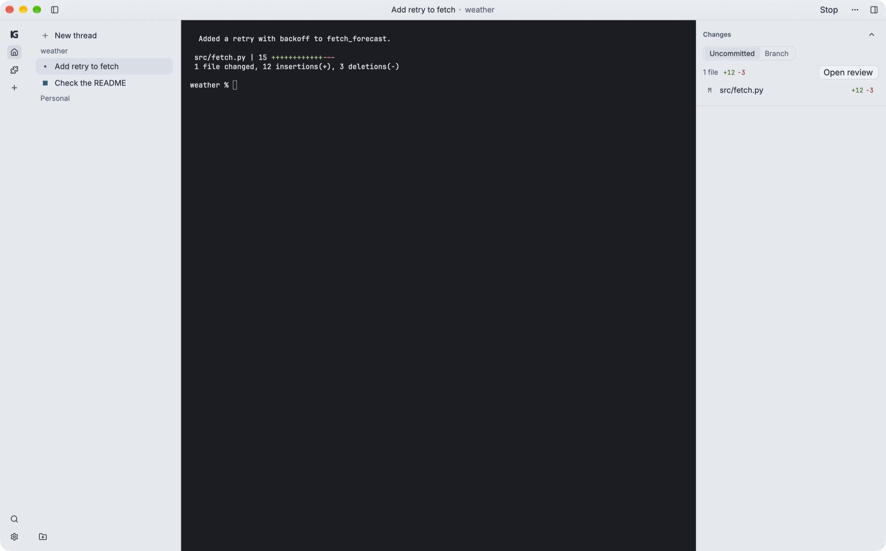

<h3 align="center">
   
  kagan
</h3>

A desktop app where agents write code with you

  <a href="#install">Install</a> · <a href="https://docs.kagan.sh/">Guide</a> · <a href="https://docs.kagan.sh/plugins.html">Plugins</a>

  <picture>
    <source media="(prefers-color-scheme: dark)" srcset="assets/readme/kagan-dark.png" />
    
  </picture>

kagan runs your agents in real terminals. Each thread runs one program in its own folder.

> [!WARNING]
> kagan is early (0.1.0). CI tests it on macOS, Linux, and Windows, but most daily use is on macOS.

## Install

On a Mac with macOS 11 or later, Intel or Apple silicon, pick one:

- **Download:** get the signed `.dmg` (one file for every Mac) from [Releases](https://github.com/kagan-sh/kagan/releases). Open it and drag `kagan.app` to `/Applications`. [Add `kg` to your `PATH`](book/src/start.md#download).
- **Homebrew:** run `brew install --cask kagan-sh/tap/kagan`. Homebrew puts `kg` on your `PATH`.

Releases also have a Windows installer, a `.deb`, and an AppImage. You can also [build from source](book/src/start.md#build-from-source).

## First run

1. Click **Add project** and select a folder, usually a git repository.
2. Select Claude Code, Codex, or another program, then press Enter.
3. Type to the program as you do in any terminal.
4. Open **Changes** to review files and send comments to the program.

For a git repository, each thread gets its own worktree by default. Your project folder does not change. [Threads](book/src/threads.md#folders) explains the other folder choices.

## Programs and plugins

A program runs with your user access and gets your environment variables. Run only programs that you trust.

For Claude Code and Codex, kagan adds its `kg` tools and a short note about kagan. Use Settings → Agents to disable this integration.

An agent can use `kg` to control threads and the window. It cannot answer an approval. Only you can approve a plugin install or more plugin powers. Only you can approve a request to delete a thread.

A plugin gets only the powers that you approve. [Plugins](book/src/plugins.md#install) lists the possible powers.

## Your data

kagan has no account, no telemetry, and no update check. Your data stays on your computer. The default folder is `~/.kagan` on macOS and Linux, or `%USERPROFILE%\.kagan` on Windows. Set `KG_DATA_DIR` to change it.

kagan uses the network only to fetch a git plugin or a plugin index that you add or update. Programs and approved plugins can use the network too.

[Your data and privacy](book/src/data.md) covers terminal text, diagnostics, updates, and removal.

## Guide

The [user guide](https://docs.kagan.sh/) covers:

- [Installation and your first thread](book/src/start.md).
- [Threads](book/src/threads.md), [reviews](book/src/review.md), and [the window](book/src/window.md).
- [Plugins](book/src/plugins.md), [skills](book/src/skills.md), and [themes](book/src/themes.md).
- [The `kg` command](book/src/cli.md) and [keyboard shortcuts](book/src/keys.md).

## Develop

Read [`AGENTS.md`](AGENTS.md) for the contributor rules. The design documents are in [`docs`](docs/architecture.md).

## License

MIT. See [LICENSE](LICENSE).

The window uses [Inter](assets/fonts/Inter-OFL.txt), and the terminal uses [JetBrains Mono](assets/fonts/JetBrainsMono-OFL.txt). Both fonts use the SIL Open Font License 1.1. The wordmark sets "kagan" in outlines of Inter. [`assets/THIRD-PARTY-NOTICES.txt`](assets/THIRD-PARTY-NOTICES.txt) has the license of each dependency and ships inside the app.
