<h3 align="center">
  <br />
  kagan
</h3>

<p align="center">A self-extensible cross platform desktop app for AI assisted software development.</p>

<p align="center">
  
</p>

<p align="center">
  <a href="#install">Install</a> · <a href="https://docs.kagan.sh/">Guide</a> · <a href="https://docs.kagan.sh/plugins.html">Plugins</a>
</p>

The program operates with your access. A plugin does not operate until you give approval. An agent cannot delete a thread. For a git repository, the thread gets its own worktree. The project folder does not change.

## Install

From the [releases page](https://github.com/kagan-sh/kagan/releases) (recommended):

For macOS 11 or later:

1. Download the signed `.dmg`.
2. Move `kagan.app` to `/Applications`.
3. Add `kg` to your `PATH`. The `.dmg` does not add `kg`. [Instructions](book/src/start.md#download).

The releases page also has a Windows installer, and a `.deb` and an AppImage for x86_64 and aarch64. [Windows and Linux](book/src/start.md).

From Homebrew:

```bash
brew install --cask kagan-sh/tap/kagan
```

This command installs `kagan.app` in `/Applications` and adds `kg` to your `PATH`.

Build from source:

```bash
git clone https://github.com/kagan-sh/kagan.git
cd kagan
cargo run -p kg --release
```

Read the [prerequisites](book/src/start.md#build-from-source). Wait several minutes for the first build. Then kagan shows the window.

kagan is new. A breaking change can occur. kagan has no account and sends no telemetry. Update checks are off until you set the checks to on. kagan keeps your data in `~/.kagan` on macOS and Linux. On Windows, kagan keeps your data in `%USERPROFILE%\.kagan`. [Privacy](book/src/data.md).

## Docs

- [Documentation](https://docs.kagan.sh)
- [Contributing](CONTRIBUTING.md)
- [Apache 2.0](LICENSE)

---

<p align="center">
  <a href="https://www.star-history.com/#kagan-sh/kagan&type=date">
    <picture>
      <source media="(prefers-color-scheme: dark)" srcset="https://api.star-history.com/svg?repos=kagan-sh/kagan&type=date&theme=dark" />
      <source media="(prefers-color-scheme: light)" srcset="https://api.star-history.com/svg?repos=kagan-sh/kagan&type=date" />
      
    </picture>
  </a>
</p>
